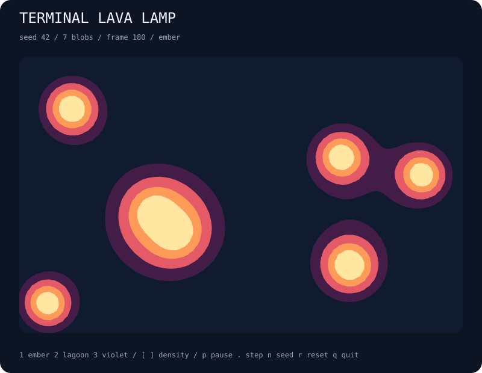

# terminal-lava-lamp

A little lava lamp for your terminal. Seeded blobs drift, merge into glowing shapes, and separate again as their fields overlap.



## Run

```bash
npx --yes github:b69ca/terminal-lava-lamp
npx --yes github:b69ca/terminal-lava-lamp --seed 7 --blobs 12 --palette lagoon
```

Node.js 20 or newer. Zero runtime dependencies. Everything runs locally.

## Play

| Key | Action |
| --- | --- |
| `p` / Space | Pause or resume |
| `.` | Pause and advance one tick |
| `1` / `2` / `3` | Ember / lagoon / violet palette |
| `[` / `]` | Lower / raise the field threshold |
| `n` | Start the next seed |
| `r` | Reset the current seed |
| `+` / `-` | Faster / slower display |
| `q` / Ctrl-C | Quit and restore the terminal |

A lower threshold makes shapes fuller and more likely to connect. A higher threshold separates their bright centers. The HUD shows the current threshold. These controls change the rendered field; individual blobs keep drifting at the same speed. Reset and next seed restore the startup palette and threshold.

Live mode uses the alternate screen and restores the cursor and input mode on exit. `--no-color` or `NO_COLOR=1` disables ANSI colors. The grid fits your terminal at startup; very small terminals may clip the minimum size.

## Export

```bash
npx --yes github:b69ca/terminal-lava-lamp --seed 42 --steps 180 --svg lava.svg
npx --yes github:b69ca/terminal-lava-lamp --seed 42 --steps 180 --json
npx --yes github:b69ca/terminal-lava-lamp --frames 200
```

| Option | Range / default |
| --- | --- |
| `--seed N` | 0–4294967295; default 42 |
| `--blobs N` | 2–16; default 7 |
| `--threshold N` | 0.6–2.2; default 1.2 |
| `--palette NAME` | ember, lagoon, violet; default ember |
| `--width N` | 24–120; export default 80 |
| `--height N` | 12–60; export default 32 |
| `--steps N` | 0–10000; live default 0, export default 180 |
| `--frames N` | 0–100000; finite terminal session |
| `--json` | Print configuration, coverage, and blob state |
| `--svg FILE` | Save a vector illustration |
| `--no-color` | Disable terminal colors |
| `--help` | Show usage |

JSON and SVG may be combined; neither accepts `--frames`. Piped output shows at most one plain snapshot with no escape sequences. Live sessions show the initial state first and advance between frames; paused frames count toward a finite limit. Exit codes: 0 success, 2 argument or file error.

## How it works

A seeded PRNG sets each blob's radius, position, and velocity in a 1.6 × 1 field. Blobs reflect at the boundaries while retaining their speed and radius. The scalar field is the sum of `radius² / (distance² + 0.001)` for every blob. Nearby contributions add together, forming connecting bridges as blobs approach.

Terminal output samples the field at cell centers. SVG samples a fixed grid, splits each cell into triangles, and interpolates contour crossings. Four filled contour bands create smooth vector shapes. The SVG has a fixed 800 × 620 canvas; terminal dimensions change ASCII sampling and JSON coverage, but not blob motion or SVG geometry.

This is procedural metaball art inspired by a lava lamp. It uses drifting particles and overlapping fields, with no fluid dynamics or temperature model. Blobs merge visually; particles remain separate and keep their original velocities. Contours are clipped at the field edges and may touch the border.

JSON reports coverage at the main threshold, not the area of all colored shading. It includes the full particle state so you can inspect positions, velocities, and radii.

## Library

Install with `npm install github:b69ca/terminal-lava-lamp`, then:

```js
import { createWorld, step, fieldAt, analyze, renderSVG } from 'terminal-lava-lamp';
const world = createWorld({ seed: 42, blobs: 7 });
step(world, 180); // Mutates and returns world.
console.log(fieldAt(world, 0.8, 0.5));
console.log(analyze(world));
const svg = renderSVG(world);
```

`render(world, { color: false })` returns a terminal snapshot. The library also exports `palettes`. Change `world.palette` to a supported palette or `world.threshold` within 0.6–2.2 between steps. Renderers and `step` expect states from `createWorld`; editing particles or dimensions directly is unsupported.

## Development

```bash
npm ci
npm run check
```

Tests check reproducibility, bounded motion, speed conservation, field addition, threshold coverage, validation, CLI errors, and exports. GitHub Actions runs Node.js 20, 22, and 24.

## License

MIT
